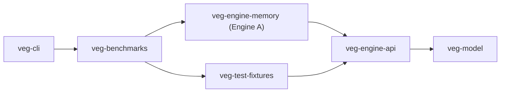

# Architektur — Stand Stufe 0 & Stufe 1

## 1. Schichtenmodell & Modulabhängigkeiten

- **`veg-model`:** Reine, unveränderliche Java-25-`record`s und `sealed interface`s (`EntityId`, `EntityKind`, `ValueType`, `Value`, `EntityNode`, `Edge`, `BootstrapIds`). Keine externen Abhängigkeiten, keine Engine-Zustände.
- **`veg-engine-api`:** Trennt konsequent zwischen:
  - `GraphReader` (reine, zustandsfreie Lese- und Traversalsicht)
  - `GraphSession` (erweitert `GraphReader` um typgeprüfte Schema- und Datenmutationen)
- **`veg-engine-memory`:** Referenzimplementierung (**Engine A**) auf Basis von Standard-`HashMap`s und Adjazenzlisten. Ziel ist maximale Nachvollziehbarkeit der Semantik und das Schaffen einer Baseline — ausdrücklich nicht Speicheroptimalität.
- **`veg-test-fixtures`:** Backend-unabhängige Contract-Suite (`Stage1ContractTestSuite`) und deterministischer Generator (`DeterministicGraphGenerator`), sodass künftige Engines (B/C) exakt dieselben Korrektheitstests erfüllen müssen (`P-01`).

---

## 2. Wie sich das Schema selbst beschreibt (Stufe 1)

Statt Typdefinitionen nur in separaten Java-Metaklassen zu verstecken, speichert `InMemoryGraphEngine` fachliche Typen **im selben Graph**:

- `defineObjectType("Person")` erzeugt:
  1. `EntityNode(#1000, META_OBJECT_TYPE, META_TYPE, empty)`
  2. `EntityNode(#1001, SYSTEM_IDENTIFIER_VALUE_TYPE, VALUE, "Person")`
  3. `Edge(#1002, #1000, HAS_NAME, #1001)` (+ `EntityNode(#1002, META_EDGE_TYPE, EDGE, empty)`)
- `defineValueType("FirstName", ValueType.STRING)` erzeugt zusätzlich:
  - `Edge(#..., #firstNameType, HAS_SCALAR_TYPE, BootstrapIds.SCALAR_STRING)`
- `definePredicate("hasFirstName", personType, firstNameType)` erzeugt zusätzlich:
  - `Edge(#..., #hasFirstName, HAS_DOMAIN, personType)`
  - `Edge(#..., #hasFirstName, HAS_RANGE, firstNameType)`

Bei jedem `createValue(...)` und `connect(...)` liest die Engine die geltenden `HAS_SCALAR_TYPE`-, `HAS_DOMAIN`- und `HAS_RANGE`-Kanten direkt aus dem Graph.

---

## 3. Bewusste Vorbereitungen und Risiken für Stufen 3–4 (Historie & Branching)

Gemäß Punkt 8 des Startauftrags dokumentieren wir explizit, welche Stufe-1-Annahmen in den Stufen 3 (Commits/Historie) und 4 (Branches/Merge) kritisch werden und wie wir die API bereits jetzt dagegen absichern:

1. **Trennung `GraphReader` vs. `GraphSession`:**  
   Lesender Code arbeitet ausschließlich gegen `GraphReader`. Wenn Stufe 3 unveränderliche `Snapshot`s (`db.snapshot(commitId)`) und Stufe 4 `BranchHead`s einführt, implementieren diese einfach `GraphReader` — bestehende Abfragen und Traversals bleiben kompatibel.
2. **Kein globales In-Place-Mutieren von `EntityNode` oder `Edge` in der öffentlichen API:**  
   `EntityNode`, `Edge` und `Value` sind unveränderliche `record`s. Stufe-3-Transaktionen können daher einen Workspace als Delta-Puffer über einem Basis-`GraphReader` führen, ohne defensive Objektkopien für jeden Lesezugriff erzwingen zu müssen.
3. **Risiko 1 — Monotoner globaler ID-Generator (`nextUserEntityId++`) bei parallelen Branches:**  
   In Stufe 1 vergibt eine einzelne `InMemoryGraphEngine` fortlaufende `long`-IDs ab `1000`. Bei parallelen Feature-Branches oder Offline-Replikation (Stufe 4 / P3) dürfen zwei Branches keine kollidierenden `EntityId`s für unterschiedliche Fachobjekte erzeugen. *Gegenmaßnahme:* `EntityId` kapselt bereits heute `long value` als opaken Typ; die ID-Vergabe sitzt hinter der Engine-Implementierung und kann in Stufe 4 auf Branch-Scoped-/HiLo-Allokatoren oder deterministische Commit-basierte IDs umgestellt werden, ohne `veg-model` zu brechen.
4. **Risiko 2 — `disconnect(edgeId)` als hartes Entfernen statt Tombstone/Versionierung:**  
   In Stufe 1 löscht `disconnect(edgeId)` Kante und Kanten-Entity physisch aus den Maps (nach Prüfung der referenziellen Integrität). Ab Stufe 3 darf kein historischer Zustand zerstört werden: `disconnect` wird dort zu einem logischen Entfernen im aktuellen Commit-Delta, während ältere Snapshots die Edge weiterhin sehen.
5. **Risiko 3 — Eindeutigkeit von Typnamen (`typeByName`) über Branches hinweg:**  
   In Stufe 1 erzwingt `InMemoryGraphEngine` einen global eindeutigen Typnamen in einer flachen `Map<String, EntityId>`. In Stufe 4 kann Branch A einen Typ `Customer` einführen und Branch B ebenfalls (mit anderer `EntityId` oder anderen Attributen). Die Namensindizes müssen dann branch-/snapshot-lokal sein, und der 3-Wege-Merge benötigt eine explizite Konfliktauflösung auf Schema-Ebene (`V-07`).
6. **Risiko 4 — `HAS_DOMAIN` / `HAS_RANGE` als Einzelkanten (`size() == 1`):**  
   Aktuell erwartet `resolveSingleSchemaTarget` genau eine Domain- und eine Range-Kante pro Prädikat. Für Vererbung (`M-06`) oder Union-Typen in Stufe 2/3 muss die Constraint-Auflösung auf Typ-Hierarchie-Traversals oder Mehrfach-Constraints verallgemeinert werden.
