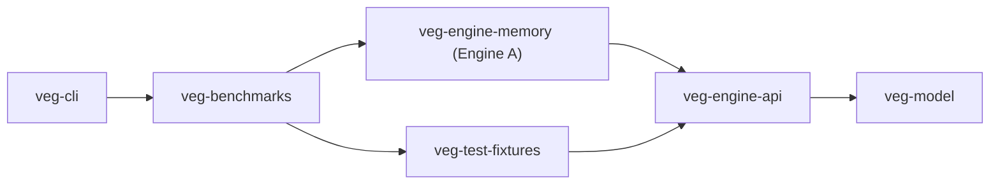

# Architektur — Stand Stufe 0 bis Stufe 4

## 1. Schichtenmodell & Modulabhängigkeiten

- **`veg-model`:** Reine, unveränderliche Java-25-`record`s und `sealed interface`s (`EntityId`, `EntityKind`, `ValueType`, `Value`, `EntityNode`, `Edge`, `BootstrapIds`). Keine externen Abhängigkeiten, keine Engine-Zustände.
- **`veg-engine-api`:** Trennt konsequent zwischen:
  - `GraphReader` (reine, zustandsfreie Lese- und Traversalsicht)
  - `GraphSession` (erweitert `GraphReader` um typgeprüfte Schema- und Datenmutationen)
- **`veg-engine-memory`:** Referenzimplementierung (**Engine A**), in Stufe 3 modularisiert in kleine, klar getrennte Klassen:
  - `MutableGraphState` (Graph-Maps, Adjazenzlisten, abgeleitete Indizes, Deep-Copy & Replay)
  - `AbstractGraphReader` & `InMemoryGraphSnapshot` (gemeinsame `GraphReader`-Basis und unveränderliche Snapshot-Sicht)
  - `BootstrapKernelInitializer` (Initialisierung des Bootstrap-Kerns `c0`)
  - `RecordedMutationSink` & `SchemaOperationsHandler` (Change-Protokollierung sowie Schema-Definition & -Evolution)
  - `GraphSchemaValidator` (Skalar-, Domain/Range-, Kardinalitäts- und Schema-Eindeutigkeitsprüfungen inkl. Bestandsprüfung bei `T06`)
  - `InMemoryGraphEngine` (schlanke `GraphSession`-Fassade, 221 Zeilen)
  - `InMemoryTransaction` (isolierter Workspace mit mehrstufigem Savepoint-Stack)
  - `InMemoryStagingWorkspace` (gruppiertes selektives Staging mit Abhängigkeitsprüfung `V-06`)
  - `CommitReverter` (Gegen-Commit-Revert-Logik mit Konfliktprüfung)
  - `ThreeWayMergeEngine` (LCA-Suche im Commit-DAG, `DataCategory`-Filterung und 6 Konfliktklassen)
  - `GraphDiffCalculator` & `InMemoryVersionedDatabase` (Commit-DAG, Branches, Tags, `asOf`, `diff`, `revert`, `merge`, `replayAsOf`)
- **`veg-test-fixtures`:** Backend-unabhängige Contract-Suiten (`Stage1ContractTestSuite`–`Stage4ContractTestSuite`) und deterministischer Generator (`DeterministicGraphGenerator`), sodass künftige Engines (B/C) exakt dieselben Korrektheitstests erfüllen müssen (`P-01`).

---

## 2. Wie sich das Schema selbst beschreibt (Stufe 1 & Stufe 2)

Statt Typdefinitionen nur in separaten Java-Metaklassen zu verstecken, speichert `InMemoryGraphEngine` fachliche Typen und Constraints **im selben Graph**:

- `defineObjectType("Person")` erzeugt:
  1. `EntityNode(#1000, META_OBJECT_TYPE, META_TYPE, empty)`
  2. `EntityNode(#1001, SYSTEM_IDENTIFIER_VALUE_TYPE, VALUE, "Person")` (inkl. `HAS_MUTABILITY -> MUTABILITY_IMMUTABLE`)
  3. `Edge(#1002, #1000, HAS_NAME, #1001)` (+ `EntityNode(#1002, META_EDGE_TYPE, EDGE, empty)`)
- `defineValueType("FirstName", ValueType.STRING, uniqueValues)` erzeugt zusätzlich:
  - `Edge(#..., #firstNameType, HAS_SCALAR_TYPE, BootstrapIds.SCALAR_STRING)`
  - `Edge(#..., #firstNameType, HAS_UNIQUE_VALUES, BooleanValue(uniqueValues))`
- `definePredicate("hasFirstName", personType, firstNameType, constraints)` erzeugt zusätzlich:
  - `Edge(#..., #hasFirstName, HAS_DOMAIN, personType)`
  - `Edge(#..., #hasFirstName, HAS_RANGE, firstNameType)`
  - optional `HAS_MAX_OUTGOING`, `HAS_MAX_INCOMING` sowie `HAS_UNIQUE_TRIPLE`
- `createValue(valueTypeId, value, mutability)` speichert am Wertknoten explizit `HAS_MUTABILITY -> MUTABILITY_IMMUTABLE` oder `MUTABILITY_SHARED_MUTABLE`.

Bei jedem `createValue(...)`, `updateValue(...)` und `connect(...)` liest die Engine diese Schema-, Mutability- und Kardinalitätskanten direkt aus dem Graph (mit einem O(1)-Sekundärindex für `uniqueValues`).

---

## 3. Bewusste Vorbereitungen und Risiken für Stufen 3–4 (Historie & Branching)

Gemäß Punkt 8 des Startauftrags dokumentieren wir explizit, welche Stufe-1-Annahmen in den Stufen 3 (Commits/Historie) und 4 (Branches/Merge) kritisch werden und wie wir die API bereits jetzt dagegen absichern:

1. **Trennung `GraphReader` vs. `GraphSession`:**  
   Lesender Code arbeitet ausschließlich gegen `GraphReader`. Wenn Stufe 3 unveränderliche `Snapshot`s (`db.snapshot(commitId)`) und Stufe 4 `BranchHead`s einführt, implementieren diese einfach `GraphReader` — bestehende Abfragen und Traversals bleiben kompatibel.
2. **Kein globales In-Place-Mutieren von `EntityNode` oder `Edge` in der öffentlichen API:**  
   `EntityNode`, `Edge` und `Value` sind unveränderliche `record`s. Stufe-3-Transaktionen können daher einen Workspace als Delta-Puffer über einem Basis-`GraphReader` führen, ohne defensive Objektkopien für jeden Lesezugriff erzwingen zu müssen.
3. **Risiko 1 — Monotoner globaler ID-Generator (`nextUserEntityId++`) bei parallelen Branches:**  
   In Stufe 1 vergibt eine einzelne `InMemoryGraphEngine` fortlaufende `long`-IDs ab `1000`. Bei parallelen Feature-Branches oder Offline-Replikation (Stufe 4 / P3) dürfen zwei Branches keine kollidierenden `EntityId`s für unterschiedliche Fachobjekte erzeugen. *Gegenmaßnahme:* `EntityId` kapselt bereits heute `long value` als opaken Typ; die ID-Vergabe sitzt hinter der Engine-Implementierung und kann in Stufe 4 auf Branch-Scoped-/HiLo-Allokatoren oder deterministische Commit-basierte IDs umgestellt werden, ohne `veg-model` zu brechen.
4. **Risiko 2 — `disconnect(edgeId)` als hartes Entfernen statt Tombstone/Versionierung:**  
   In Stufe 1 löscht `disconnect(edgeId)` Kante und Kanten-Entity physisch aus den Maps (nach Prüfung der referenziellen Integrität). Ab Stufe 3 darf kein historischer Zustand zerstört werden: `disconnect` wird dort zu einem logischen Entfernen im aktuellen Commit-Delta, während ältere Snapshots die Edge weiterhin sehen.
5. **Risiko 3 — Eindeutigkeit von Typnamen (`typeByName`) über Branches hinweg:**  
   In Stufe 1 erzwingt `InMemoryGraphEngine` einen global eindeutigen Typnamen in einer flachen `Map<String, EntityId>`. In Stufe 4 kann Branch A einen Typ `Customer` einführen und Branch B ebenfalls (mit anderer `EntityId` oder anderen Attributen). Die Namensindizes müssen dann branch-/snapshot-lokal sein, und der 3-Wege-Merge benötigt eine explizite Konfliktauflösung auf Schema-Ebene (`V-07`).
6. **Risiko 4 — `HAS_DOMAIN` / `HAS_RANGE` als Einzelkanten (`size() == 1`):**  
   Aktuell erwartet `resolveSingleSchemaTarget` genau eine Domain- und eine Range-Kante pro Prädikat. Für Vererbung (`M-06`) oder Union-Typen in Stufe 2/3 muss die Constraint-Auflösung auf Typ-Hierarchie-Traversals oder Mehrfach-Constraints verallgemeinert werden.

## Stufe-5-Modularisierung (`veg-engine-memory`)

Um `InMemoryGraphEngine` dauerhaft schlank zu halten, kapseln dedizierte Paketklassen die Querschnittsaufgaben der Zugriffskontrolle und Inferenz:

- `AccessControlOperationsHandler` — Anlage und Validierung graphbasierter Principals (`META_PRINCIPAL_TYPE`), Gruppen (`MEMBER_OF_GROUP`), ACL-Einträge (`META_ACL_ENTRY_TYPE`), Propagationsregeln (`META_PROPAGATION_RULE_TYPE`) sowie Prädikat-Relationen (`HAS_INVERSE_PREDICATE`, `HAS_SUPER_PREDICATE`).
- `PermissionEvaluator` — Zyklussichere BFS-Evaluation über Gruppen, Typen, Kantenendpunkte und `PropagationRule`s unter **Default Deny** und **"Verbieten gewinnt"** inkl. `AccessDecision`-Diagnosepfad.
- `SemanticInferenceEngine` — Zyklussichere Query-Time-Auflösung expliziter vs. abgeleiteter Aussagen (`DerivedAssertion`).
- `AuthorizedGraphReaderImpl` — Akteursspezifischer `AuthorizedGraphReader` mit stiller Filterung, `AccessDeniedException`, Branch-Restriktionen (`S-05`) und `HEAD`-Rückwärtsprüfung für `authorizedAsOf` (`T14`).

## Stufe-6-Schicht (`veg-engine-api` & `veg-model`)

Query- und RDF-Interoperabilität liegen bewusst in `veg-engine-api` über das abstrakte `GraphReader`-/`GraphSession`-Interface:

- `GraphQuery` & `GraphQueryDsl` (`veg-engine-api`) — Storage-unabhängige Abfrage-, Join-, Filter-, Sortier- und Paging-Schicht über Live-Snapshots, historische `asOf`-Zustände und `AuthorizedGraphReader`.
- `RdfGraphExporter` & `RdfGraphImporter` (`veg-engine-api`) — Eigenständiger Turtle-(`.ttl`) und N-Triples-(`.nt`) Export/Import mit Reifikation (`rdf:Statement`), Typ-Treue und expliziter Warnung bei unterdrückter Provenienz (`T18`).
